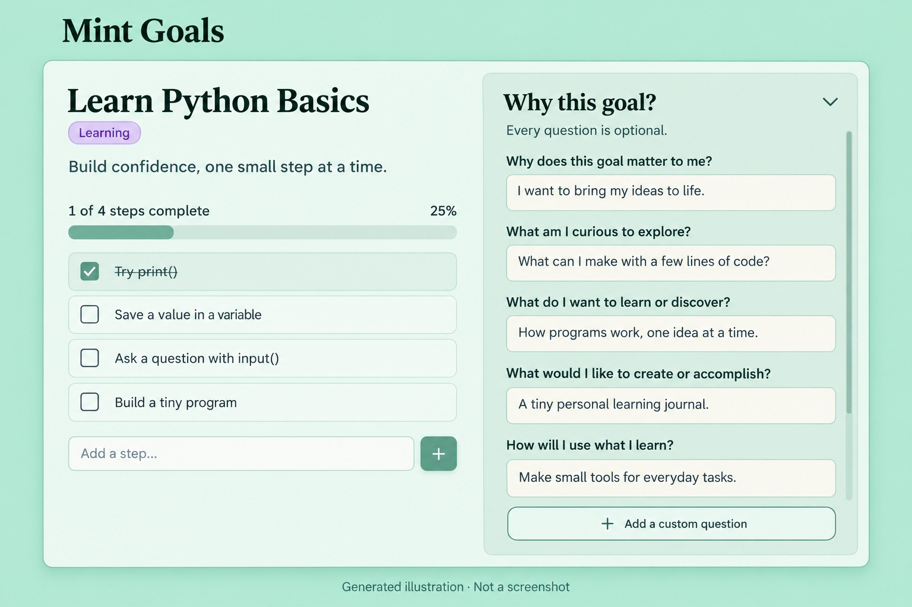

# Mint Goals

A quiet mint-green goal planner: break goals into steps, choose icons and emojis,
organize categories, keep optional ideas and intentions beside each goal’s steps,
and see completed goals over time.

## Start using Mint Goals

**[Use Mint Goals online](https://mint-goals.aurorax.chatgpt.site)** — no installation:
this opens the shared hosted web app, not a new copy of the Site. Click **Sign in
with ChatGPT** and use your own ChatGPT account. You can also open the
[sign-in page](https://mint-goals.aurorax.chatgpt.site/signin-with-chatgpt?return_to=%2F)
directly. The app stores goals separately by signed-in account; it does not show
another visitor's goals. Internet and ChatGPT sign-in are required. Account
isolation is covered by automated API tests; a live two-account visitor test has
not been performed. If your session expires, export unsaved edits, sign in in the
new tab offered by the app, then return and retry saving.

Prefer no account or internet? Download the offline edition below. Developers can
also deploy their own Sites copy.

## Updated design preview



**Illustrative preview, generated from the current design. Not an actual screenshot.**
It uses fictional sample answers and simplifies the layout to show the optional
questions together. The running app may look different at your screen size.

## Choose your edition

| Edition | Start here | Storage | Internet / account |
| --- | --- | --- | --- |
| **Offline** | [`offline/index.html`](offline/index.html) | This browser on this device | No ChatGPT account, backend, or internet required after download |
| **ChatGPT Sites** | [`sites/README.md`](sites/README.md) | Your own private Sites deployment with per-user D1 storage | Requires ChatGPT Sites and sign-in; online access |

### 1. Offline: download and open

1. On GitHub, choose **Code → Download ZIP**, then extract it.
2. Open `offline/index.html` in a current desktop browser (Chrome, Edge, Firefox, or Safari).
3. Create a goal, add steps/categories, and use **Export backup** regularly.

The HTML contains all its JavaScript, CSS and icons. There are no CDN assets,
remote fonts, analytics, API calls or ChatGPT connections. Its Content Security
Policy blocks network connections. You do not need Node or Python to open it.

**Important browser-storage limits:** data belongs to this browser/profile and
location, not the downloaded HTML file. Private browsing, clearing browser data,
moving/renaming the HTML, switching browsers or devices, and browser storage
restrictions can lose access to saved goals. `file://` storage behavior varies
between browsers. Keep exported JSON backups somewhere safe; never rely on the
HTML file itself as a backup. Use one editing tab at a time. A revision check warns
about stale tabs but browser storage is not a transactional multi-user database.
Goals are not encrypted against people who can access your browser profile.

If direct-file storage is unavailable, use a local server (Python 3 required):

```sh
cd mint-goals-main/offline
python3 -m http.server 8080 --bind 127.0.0.1
```

On Windows, use `py -m http.server 8080 --bind 127.0.0.1` instead. Open
`http://127.0.0.1:8080/`. Keep that terminal running while opening/reloading the
app; press Ctrl+C to stop it. This serves only local files and needs no internet.
Always use the same browser and address/port to return to the same saved data.
The extracted folder's name may differ; `cd` into its `offline` folder.

### 2. ChatGPT Sites: create your own private app

Follow [`sites/README.md`](sites/README.md). This is reusable source, not access to
someone else's account. Create a **new** Site with its own project identity,
ChatGPT authentication and D1 database. The repository does not contain deployed project IDs, credentials, user goals,
or deployment history. The offline edition, the shared online app,
and any separately deployed Sites copy are separate stores.

## Features in both editions

- Goals with small steps, optional descriptions, icons and task emojis.
- Categories, task reordering, completion/reopening and archiving.
- An entirely optional **Why this goal?** pane next to each goal’s steps: five
  reflection questions and your own editable question/answer pairs. Collapse it
  without losing answers; the pane scrolls independently and stacks on mobile.
- Answers belong to that goal, not a global scratchpad. No AI and no required
  questionnaire: leaving every field blank never blocks creating or completing goals.
- Weekly/monthly completion charts, category filters, accessible chart tables,
  and a completed-goal timeline.
- Typical duration is **median elapsed days**, not hours worked.
- Older completion dates stay **unknown**. Optional manually entered dates are
  marked and excluded from duration calculations; no history is invented.
- One current completion per goal, including archived completed goals. Reopening
  removes that completion; completing again records the latest date.

## Move your own goals between editions

1. In the source edition, click **Export backup**.
2. In the other edition, click **Import backup** and choose that JSON file.
3. Review the count, then confirm **Add to my goals**.

Both accept Mint Goals v1/v2/v3 backups and export v3. Categories, icons, task emojis,
completion timestamps, known manual dates, five reflection answers and custom
question/answer pairs are retained. Import adds goals with
fresh IDs; it does **not** merge or synchronize them. Importing the same backup
twice creates duplicates. Existing goals are not replaced. Date-unknown legacy
goals stay unknown. JSON backups contain your private text—do not commit them here.

## Development / checks

Offline source is in `offline/src`. With Node 22+:

```sh
cd offline
npm test
npm run build
```

No npm packages are required for the offline edition. The build regenerates its
self-contained `index.html`. Sites has its own dependencies and test/build steps.

## Verification limits

The offline app was exercised in an isolated Chromium local origin with the
serving process stopped after initial load and network connections denied by CSP.
Creation, step completion and goal completion worked without a backend. Automated
tests cover persistence failures, stale saves, backup dates and calendar buckets.
Direct `file://` launch was not testable in the cloud browser; that browser blocks
file URLs. Mobile file-opening/storage behavior is browser-dependent.

No license has been selected; this repository does not grant a specific open-source
license. Existing third-party notices in the Sites source remain applicable.

## Ideas and intentions: limits and saving

The five questions are: why this goal matters, what you are curious to explore,
what you want to learn or discover, what you want to create or accomplish, and
how you will use what you learn. Each answer allows 2,000 characters. Add up to
100 custom questions per goal (300 characters per question; 2,000 per answer).
Every field is optional, including newly added blank questions.

The whole notebook still has a roughly 1.99 MB UTF-8 data budget; the per-field
limits do not promise that every goal can be filled to every maximum at once.
Over-limit input is not truncated: it stays as an unsaved, exportable draft in
the open tab. Shorten it before closing or export first. An over-limit backup
needs shortening before reimport. Check the save status; failed or conflicting
saves do not become saved merely because the text remains visible.

The hosted edition binds saves to the account that loaded the notebook. If you
switch accounts elsewhere, it refuses to copy the first account’s goals into
the second and keeps your draft for export. Older open tabs must export pending
edits and reload this updated version.

This update passed automated model, storage, account-switch, backup interchange,
and DOM event-handler tests. It did not receive a new rendered-browser pass:
the managed preview route was unavailable. The screenshot above predates the
optional right-hand pane.
